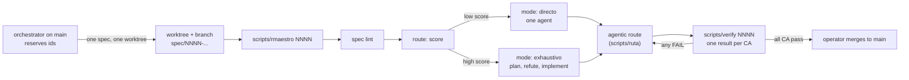

# spec-harness

A small harness for working with coding agents **one spec at a time**: an
orchestrator session on `main` reserves ids and opens every spec in its own
worktree; `rmaestro` takes the spec from lint to route to a working mode to a
chain of subagents to `verify`; and one contract (`AGENTS.md`) governs every
agent that touches the repo.

This is a one-time public snapshot of the harness I use every day. It is not
kept in sync with the private repository it came from.

## The problem

Agents are fast and confident, and that is exactly the problem. Left alone they
widen the scope, declare "done" without proof, run several sessions on the same
checkout and step on each other, and leave no trace of what was decided or why.
The more autonomy you give them, the more the work needs to be bounded
before it starts and checked after it ends.

## Why Claude Code alone is not enough

Claude Code gives you a very good agent in a session. It does not give you the
process around the session:

- **A written contract per task.** Each change starts as a spec in `specs/`
  with numbered requirements and binary acceptance criteria (CA), each with a
  `check:` command that decides pass or fail. `scripts/spec lint` rejects a spec
  that is incomplete or still has the template placeholders.
- **Scope and escalation.** `AGENTS.md` says: read the active spec, do not exceed
  its scope, escalate as soon as a hard trigger or the complexity threshold is
  crossed.
- **Red before green.** A criterion is "done" only when its check was seen
  failing first and passing after (`scripts/verify <id> --ca CA-NN`).
- **Parallel work that does not collide.** One spec, one worktree, one branch.
  Agents never check out another branch and never touch `main`.
- **Effort proportional to the task.** `scripts/route` scores the spec and
  `scripts/rmaestro` turns the score into a working mode (`directo` or
  `exhaustivo`) with its own contract in `templates/MODE.md.*`.
- **A record.** Every agentic run is appended to `sessions/rutas.jsonl`
  (a few example lines are included here).

## How the harness works

1. **Spec.** `scripts/spec new` creates `specs/NNNN-title.md` from
   `templates/spec.md`; `scripts/spec lint` validates it; `approve` and `start`
   move its `status` (`draft`, `approved`, `implementing`, `verified`).
2. **Route.** `scripts/route --spec NNNN` scores complexity from
   `config/routing.yaml` (requirements, paths touched, blockers, LOC, hard
   exclusions) and picks a mode.
3. **Mode.** `scripts/rmaestro NNNN` runs the two steps above and prints a last
   line such as `MODO=directo CONTRATO=templates/MODE.md.directo SPEC=NNNN`. The
   contract says how deep to plan, how destructive commands are approved, and how
   verbose the log is.
4. **Agentic route.** The workflows in `.claude/workflows/` chain subagents
   (planner, implementer, refuter, verifier from `.claude/agents/`) with a model
   and effort set in `config/rutas.yaml`. `scripts/ruta` runs one from any
   terminal.
5. **Verify.** `scripts/verify NNNN` runs every `check:` and prints one line per
   criterion, never an aggregate.

Suggested reading order: `AGENTS.md`, `templates/MODE.md.directo`,
`specs/0001-repo-maestro.md`, then any spec you are curious about.

## Run it with another agent or host

See [HOSTS.md](HOSTS.md). In short: the core is plain `bash`, `git` and
`node`; anything that can read `AGENTS.md` and run the scripts can follow the
contract, and only the parts that launch subagents need the `claude` binary.

## Limits

- It is a snapshot: specs and scripts reference history that is not here, and
  nothing is synced with the source repository.
- `scripts/doctor` does not go green in this copy: it checks for a pinned
  agent binary that is not published.
- The scoring weights in `config/routing.yaml` are calibrated on my own runs;
  treat them as a starting point.
- Agentic routes need the `claude` CLI logged in; without it you can still
  implement a spec by hand under the same contract.
- Some specs cite other specs that were left out. Their `§Traza` sections
  are emptied on purpose.
- `sessions/rutas.jsonl` holds, at most, a handful of example runs with the
  free-text notes removed.

## Status

Example specs included in this snapshot (the full set stays in the private repo):

- [0001](specs/0001-repo-maestro.md) — Repo maestro spec-driven (resumen público de la spec madre)
- [0021](specs/0021-rutas-agenticas-route-elige-un-workflow-de-subagentes-por-modo.md) — Rutas agénticas: `route` elige un workflow de subagentes por modo
- [0036](specs/0036-verify-ca-un-ca-por-scripts-verify-nunca-el-check-copiado-a-mano.md) — verify --ca: un CA por scripts/verify, nunca el check copiado a mano
- [0055](specs/0055-todo-worktree-nuevo-arranca-con-un-brainstorm-de-alternativas.md) — Todo worktree nuevo arranca con un brainstorm de alternativas
- [0070](specs/0070-tdd-rojo-antes-de-verde-y-reglas-de-the-clean-coder.md) — TDD rojo antes de verde y reglas de The Clean Coder
