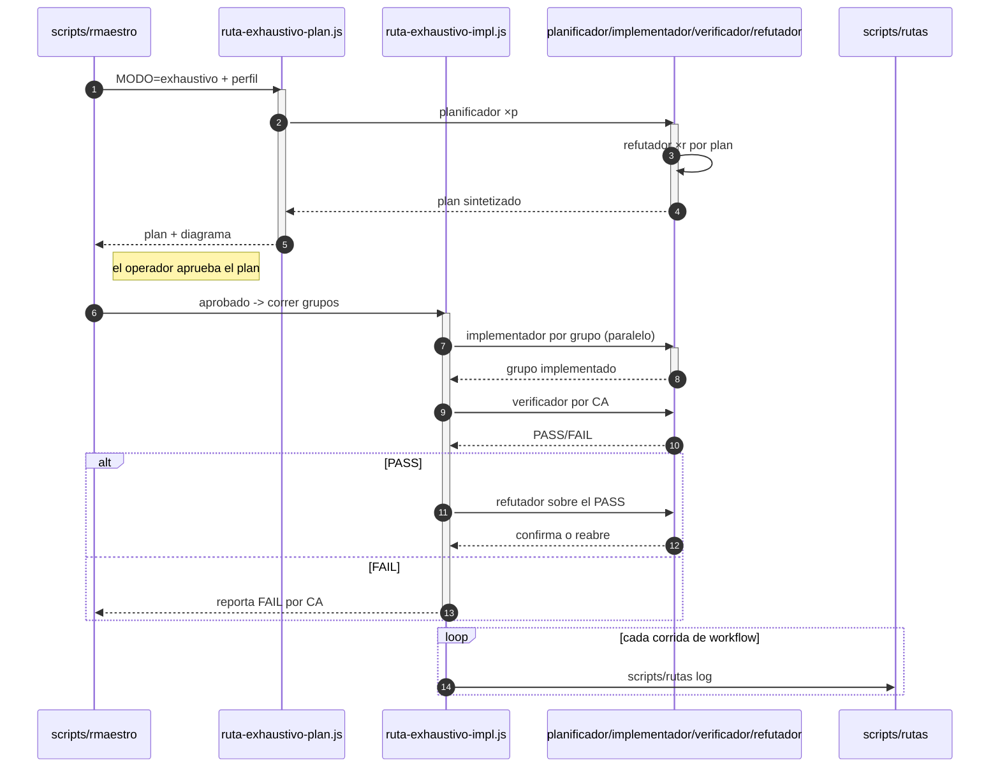

# SPEC — Rutas agénticas: `route` elige un workflow de subagentes por modo

**Spec madre:** `specs/0001-repo-maestro.md`. Esta spec extiende RF-26 madre
(modo de trabajo por complejidad, `spec 0014 (not in this snapshot)`): hoy el
modo (`directo`/`exhaustivo`) le dice al agente de la sesión **cómo actuar**;
con esta spec, además, le dice **qué ruta agéntica correr** — qué subagentes
se lanzan, en qué orden, qué corre en paralelo y qué verifica a qué. Todo
sobre primitivas que el harness ya trae (definiciones de subagentes en
`.claude/agents/`, workflows guardados en `.claude/workflows/`): nada de
runtimes nuevos, nada de orquestador propio. No reabre el scorer (0002), el
ciclo de vida (0003), `rmaestro` (0012) ni los contratos de modo (0014) más
allá de lo que acá se enumera con nombre; ante conflicto, ganan ellas y la
madre por encima de todas.

**Destinatario:** agente de implementación con acceso a shell, filesystem
local y git, operando dentro de Claude Code (necesita las herramientas
`Agent` y `Workflow` para la parte manual de §6). Sin red, sin credenciales.

**Idioma:** documentación y comentarios en español rioplatense;
identificadores, paths y claves de config en inglés.

---

```yaml
id: "0021"
title: "Rutas agénticas: route elige un workflow de subagentes por modo"
version: 6
status: verified
created_at: 2026-09-15
updated_at: 2026-09-16
schema_change: false
arch_decision: false
target_branch: "spec/0021-rutas-agenticas"
loc_estimate: 450
tier_locked: null
supersedes: null
```

---

## 1. Objetivo

Que el resultado de `scripts/rmaestro` (`MODO=directo|exhaustivo`) se
traduzca en una **ruta agéntica concreta y versionada en el repo**: un
conjunto de subagentes con contrato propio y uno o más workflows guardados
que los orquestan con paralelismo determinístico. El agente de la sesión
deja de improvisar "cuántos agentes lanzo y en qué orden" y pasa a correr la
ruta que el repo declara para ese modo.

Problema que resuelve: el operador quiere rutear agentes y correr trabajo en
paralelo con el menor lag y costo posible. El costo y el lag los dominan las
llamadas al modelo, no el orquestador; por eso la solución no es un runtime
nuevo (se descartó un rewrite en Rust el 2026-09-15) sino **no gastar
tokens en orquestar**: el orquestador es un script JS determinístico
(`Workflow`) y el paralelismo lo da `pipeline`/`parallel` del harness. Como
segundo entregable, la misma pieza sirve para **rutinas**: workflows que se
corren solos, a intervalo, sin operador — se entrega una rutina de salud
del repo como primer caso, ejecutable offline.

---

## 2. Alcance

### 2.1 Dentro de alcance (IN)

- Definiciones de subagentes en `.claude/agents/` (RF-01): `planificador`,
  `implementador`, `verificador`, `refutador`.
- Workflows guardados en `.claude/workflows/` (RF-02/RF-03): uno para
  `directo`, dos para `exhaustivo` (plan, implementación), más la rutina de
  salud del repo (RF-05).
- Mapeo modo → workflows declarado en `config/rutas.yaml` y leído por un
  script Bash nuevo, `scripts/rutas` (RF-04), determinístico y offline.
- Sección nueva "Ruta agéntica" en `templates/MODE.md.directo` y
  `.exhaustivo`, y paso nuevo en `.claude/commands/rmaestro.md` (RF-06).
- Documento `docs/rutas-agenticas.md`: cómo se corre una ruta, cómo se
  agrega una, cómo se agenda una rutina (RF-07).

### 2.2 Fuera de alcance (OUT)

- Cambiar `scripts/rmaestro`, `scripts/route`, `scripts/spec`,
  `config/routing.yaml` o el scorer. La salida `MODO=... CONTRATO=... SPEC=...`
  queda idéntica; la ruta se resuelve **después**, por `scripts/rutas`.
- Rewrite de herramientas en Rust o cualquier otro runtime (descartado el
  2026-09-15; si algún día hace falta un binario distribuible, spec propia).
- Rutinas que dependan de MCP autenticado interactivamente (Gmail,
  Calendar, ads-platform Ads — la skill de 0018/0019): en ejecución headless esos
  servidores pueden no estar; queda para una spec siguiente cuando se
  confirme el entorno de rutinas del equipo (§7 D3).
- Agendar efectivamente la rutina (cron/`/schedule`): esta spec entrega el
  workflow y el procedimiento documentado; agendarla es una acción del
  operador sobre su cuenta, no un artefacto del repo.
- Camino legado (`scripts/session`, `kill`, `escalate`, `bootstrap`): intacto.

---

## 3. Requerimientos funcionales

**RF-01 — Subagentes con contrato (extiende RF-26 madre).** Cuatro archivos
en `.claude/agents/`, cada uno con front-matter `name`, `description`,
`tools` y cuerpo en español:

- `planificador.md` — sólo lectura (`Read`, `Grep`, `Glob`, `Bash` de
  lectura). Recibe una spec y devuelve un plan: archivos y CA afectados,
  casos borde, supuestos. Nunca edita.
- `implementador.md` — edita dentro del §Alcance de la spec que recibe;
  no commitea, no pushea, no toca hooks ni config fuera de alcance.
- `verificador.md` — corre `scripts/verify <id>`, `scripts/spec lint <id>`
  y `bash scripts/doctor`; devuelve el desglose por CA, nunca un agregado.
- `refutador.md` — recibe una afirmación ("CA-03 pasa", "el plan cubre
  RF-02") e intenta refutarla; ante duda, refuta.

Todos ordenan leer `AGENTS.md` y la spec activa antes de actuar, y ninguno
ejecuta acciones irreversibles (`git push`, `rm -rf`, `git reset --hard`).

**RF-02 — Ruta `directo`.** `.claude/workflows/ruta-directo.js`: un
`implementador` sobre la spec, seguido de un `verificador`; si el
verificador reporta algún CA en FAIL, una segunda vuelta del `implementador`
con el desglose, y un `verificador` final. Devuelve `{ca: [...], pasa:
bool}`. Máximo 4 agentes.

**RF-03 — Ruta `exhaustivo`, en dos workflows con el operador en el
medio.** El contrato `exhaustivo` exige plan aprobado por el operador antes
de tocar código, y un workflow no puede pausar a esperar aprobación; por eso
la ruta son dos scripts:

- `ruta-exhaustivo-plan.js` — panel de 3 `planificador` con enfoques
  distintos (mínimo viable primero, riesgo primero, CA primero), 3
  `refutador` en paralelo sobre cada plan, y una síntesis. Devuelve el plan
  ganador con los reparos sobrevivientes. No edita nada.
- `ruta-exhaustivo-impl.js` — recibe por `args` el plan aprobado; corre
  `implementador` por grupo de archivos del plan (en `pipeline`, con
  `isolation: 'worktree'` sólo si dos grupos tocan el mismo archivo), luego
  `verificador` por CA en paralelo y `refutador` sobre cada CA que pasó.
  Devuelve el desglose por CA con veredicto.

Entre ambos, el agente de la sesión muestra el plan al operador y espera su
aprobación explícita (RF-04 de 0014 sigue rigiendo).

**RF-04 — `scripts/rutas` y `config/rutas.yaml`.** `scripts/rutas <modo>`
imprime, una por línea y en orden, `WORKFLOW=<ruta relativa>` para cada
workflow declarado en `config/rutas.yaml` bajo ese modo, y falla con exit 2
si el modo no existe o algún archivo declarado no está. `scripts/rutas
--lint` valida todo el catálogo: cada agente de `.claude/agents/` tiene los
tres campos de front-matter; cada workflow de `.claude/workflows/` arranca
con `export const meta = {` y pasa `node --input-type=module --check` envuelto
como lo envuelve el runtime de `Workflow` (`export` quitado, cuerpo dentro de
una función async: el `return` de nivel superior es válido ahí).
Determinístico, offline, sin hora ni entorno (mismo criterio que RF-06
madre).

**RF-05 — Rutina `salud-repo`.** `.claude/workflows/rutina-salud-repo.js`:
para cada spec en `status: implementing` (lista recibida por `args`, que la
arma quien la agenda con `grep`), un `verificador` en paralelo; devuelve
`{specs: [{id, ca_fail: [...]}], doctor_ok: bool}`. Es la primera rutina
del repo: corre sin operador, sin MCP autenticado, y su salida es un
informe legible que se puede pegar en un chat o publicar como artefacto.

**RF-06 — Contratos y comando.** Cada `templates/MODE.md.<modo>` gana una
sección `## Ruta agéntica` al final, que remite a `scripts/rutas <modo>` y
dice cuándo correr cada workflow (para `exhaustivo`: plan → aprobación →
impl). `.claude/commands/rmaestro.md` gana, en "Adoptar el modo", el paso
"correr `scripts/rutas <modo>` y lanzar los workflows listados con la
herramienta `Workflow` en el orden impreso". Nada más cambia en esos tres
archivos.

**RF-07 — Documentación.** `docs/rutas-agenticas.md`: qué es una ruta, la
tabla modo → workflows, cómo agregar un agente o un workflow (y correr
`scripts/rutas --lint`), y cómo agendar la rutina de RF-05 con `/schedule`
(receta paso a paso, sin ejecutarla).

---

## 4. Requerimientos no funcionales

**RNF-01 — Formato y dependencias (hereda RNF-06 madre).** `scripts/rutas`
en Bash con `set -euo pipefail`; workflows en JavaScript plano (no
TypeScript), sin `Date.now()`/`Math.random()`; agentes en Markdown con
front-matter YAML. Sin runtime nuevo: Node (ya requerido por RNF-01 madre)
y coreutils.

**RNF-02 — Orquestador sin tokens.** Ningún workflow usa un agente para
decidir control de flujo (orden, paralelismo, reintentos): eso es código
del script. Los agentes producen trabajo o veredictos, nada más.

**RNF-03 — `scripts/rmaestro`, `scripts/route`, `scripts/spec`,
`config/routing.yaml` y el camino legado byte a byte intactos** respecto
del commit `005ae7c`.

**RNF-04 — Reglas de irreversibilidad heredadas.** Ningún subagente ni
workflow ejecuta `git push`, `git reset --hard`, `rm -rf` fuera de
`.state/`, ni edita hooks o credenciales. Commitear sigue siendo del agente
de la sesión, con el operador.

**RNF-05 — Determinismo de `scripts/rutas` (hereda RNF-07 madre).** Dos
corridas sobre el mismo repo dan stdout byte-idéntico.

---

## 5. Estructura del entregable

### 5.1 Archivos nuevos o reemplazados

```
.claude/
  agents/
    planificador.md            # nuevo (RF-01)
    implementador.md           # nuevo (RF-01)
    verificador.md             # nuevo (RF-01)
    refutador.md               # nuevo (RF-01)
  workflows/
    ruta-directo.js            # nuevo (RF-02)
    ruta-exhaustivo-plan.js    # nuevo (RF-03)
    ruta-exhaustivo-impl.js    # nuevo (RF-03)
    rutina-salud-repo.js       # nuevo (RF-05)
  commands/
    rmaestro.md                # delta: paso "correr scripts/rutas" (RF-06)
config/
  rutas.yaml                   # nuevo (RF-04)
scripts/
  rutas                        # nuevo (RF-04)
templates/
  MODE.md.directo              # delta: sección "## Ruta agéntica" (RF-06)
  MODE.md.exhaustivo           # delta: sección "## Ruta agéntica" (RF-06)
docs/
  rutas-agenticas.md           # nuevo (RF-07)
```

### 5.3 Secuencia

```diagrama
capas:
  - { id: cli, nombre: "scripts/rmaestro" }
  - { id: workflows, nombre: Workflows }
  - { id: agentes, nombre: Subagentes }
  - { id: registro, nombre: Registro }
participantes:
  - { id: Rm, nombre: "scripts/rmaestro", capa: cli, hace: "Emite MODO y perfil, lanza el workflow de plan y después el de impl", vive_en: ["scripts/rmaestro"] }
  - { id: Wp, nombre: "ruta-exhaustivo-plan.js", capa: workflows, hace: "Arma el panel de planificadores ×p y refutadores ×r, sintetiza un plan", vive_en: [".claude/workflows/ruta-exhaustivo-plan.js"] }
  - { id: Wi, nombre: "ruta-exhaustivo-impl.js", capa: workflows, hace: "Corre los grupos del plan en paralelo, un verificador por CA y un refutador por PASS", vive_en: [".claude/workflows/ruta-exhaustivo-impl.js"] }
  - { id: Ag, nombre: "planificador/implementador/verificador/refutador", capa: agentes, hace: "Subagentes que arman el panel, implementan cada grupo y verifican/refutan", vive_en: [".claude/agents/planificador.md", ".claude/agents/implementador.md", ".claude/agents/verificador.md", ".claude/agents/refutador.md"] }
  - { id: Rt, nombre: "scripts/rutas", capa: registro, hace: "Registra cada corrida de workflow", vive_en: ["scripts/rutas", "sessions/rutas.jsonl"] }
secuencia:
  - { de: Rm, a: Wp, msg: "MODO=exhaustivo + perfil", tipo: peticion, activa: true }
  - { de: Wp, a: Ag, msg: "planificador ×p", tipo: peticion, activa: true }
  - { de: Ag, a: Ag, msg: "refutador ×r por plan", tipo: peticion }
  - { de: Ag, a: Wp, msg: "plan sintetizado", tipo: respuesta }
  - { de: Wp, a: Rm, msg: "plan + diagrama", tipo: respuesta }
  - { nota: "el operador aprueba el plan", sobre: Rm }
  - { de: Rm, a: Wi, msg: "aprobado -> correr grupos", tipo: peticion, activa: true }
  - { de: Wi, a: Ag, msg: "implementador por grupo (paralelo)", tipo: peticion, activa: true }
  - { de: Ag, a: Wi, msg: "grupo implementado", tipo: respuesta }
  - { de: Wi, a: Ag, msg: "verificador por CA", tipo: peticion }
  - { de: Ag, a: Wi, msg: "PASS/FAIL", tipo: respuesta }
  - alt: "PASS"
    pasos:
      - { de: Wi, a: Ag, msg: "refutador sobre el PASS", tipo: peticion }
      - { de: Ag, a: Wi, msg: "confirma o reabre", tipo: respuesta }
    else: "FAIL"
    pasos_else:
      - { de: Wi, a: Rm, msg: "reporta FAIL por CA", tipo: respuesta }
  - loop: "cada corrida de workflow"
    pasos:
      - { de: Wi, a: Rt, msg: "scripts/rutas log", tipo: peticion }
```

<!-- diagrama:inicio -->


| Capa | Participante | Qué hace | Dónde vive |
|---|---|---|---|
| scripts/rmaestro | scripts/rmaestro | Emite MODO y perfil, lanza el workflow de plan y después el de impl | `scripts/rmaestro` |
| Workflows | ruta-exhaustivo-plan.js | Arma el panel de planificadores ×p y refutadores ×r, sintetiza un plan | `.claude/workflows/ruta-exhaustivo-plan.js` |
| Workflows | ruta-exhaustivo-impl.js | Corre los grupos del plan en paralelo, un verificador por CA y un refutador por PASS | `.claude/workflows/ruta-exhaustivo-impl.js` |
| Subagentes | planificador/implementador/verificador/refutador | Subagentes que arman el panel, implementan cada grupo y verifican/refutan | `.claude/agents/planificador.md`, `.claude/agents/implementador.md`, `.claude/agents/verificador.md`, `.claude/agents/refutador.md` |
| Registro | scripts/rutas | Registra cada corrida de workflow | `scripts/rutas`, `sessions/rutas.jsonl` |
<!-- diagrama:fin -->
---

## 6. Criterios de aceptación

Binarios. La spec está cumplida si y sólo si los 9 pasan.

- **CA-01** — Los cuatro agentes existen con los tres campos de front-matter
  y ninguno autoriza acciones irreversibles.
  ```yaml
  check:
    cmd: |
      ok=1
      for a in planificador implementador verificador refutador; do
        f=".claude/agents/$a.md"
        [ -f "$f" ] || ok=0
        grep -qE '^name:' "$f" || ok=0
        grep -qE '^description:' "$f" || ok=0
        grep -qE '^tools:' "$f" || ok=0
        grep -q 'AGENTS.md' "$f" || ok=0
        grep -qiE 'nunca.*(git push|irreversible)' "$f" || ok=0
      done
      [ "$ok" -eq 1 ]
    expect_exit: 0
  ```

- **CA-02** — Los cuatro workflows arrancan con `meta` literal y son JS
  válido como módulo.
  ```yaml
  check:
    cmd: |
      ok=1
      for w in ruta-directo ruta-exhaustivo-plan ruta-exhaustivo-impl rutina-salud-repo; do
        f=".claude/workflows/$w.js"
        [ -f "$f" ] || ok=0
        head -1 "$f" | grep -q '^export const meta = {' || ok=0
        { printf '(async () => {\n'; sed '1s/^export //' "$f"; printf '\n})\n'; } | node --input-type=module --check >/dev/null 2>&1 || ok=0
        grep -qE 'Date\.now|Math\.random|new Date\(\)' "$f" && ok=0
      done
      [ "$ok" -eq 1 ]
    expect_exit: 0
  ```

- **CA-03** — `scripts/rutas directo` imprime exactamente un `WORKFLOW=` y
  `scripts/rutas exhaustivo` exactamente dos, en orden plan → impl, y todos
  apuntan a archivos existentes.
  ```yaml
  check:
    cmd: |
      ok=1
      d="$(scripts/rutas directo)"
      [ "$(printf '%s\n' "$d" | grep -c '^WORKFLOW=')" -eq 1 ] || ok=0
      e="$(scripts/rutas exhaustivo)"
      [ "$(printf '%s\n' "$e" | grep -c '^WORKFLOW=')" -eq 2 ] || ok=0
      printf '%s\n' "$e" | sed -n 1p | grep -q 'exhaustivo-plan' || ok=0
      printf '%s\n' "$e" | sed -n 2p | grep -q 'exhaustivo-impl' || ok=0
      for l in $d $e; do f="${l#WORKFLOW=}"; [ -f "$f" ] || ok=0; done
      [ "$ok" -eq 1 ]
    expect_exit: 0
  ```

- **CA-04** — Modo inexistente y archivo declarado ausente fallan con exit 2.
  ```yaml
  check:
    cmd: |
      ok=1
      scripts/rutas inexistente >/dev/null 2>&1; [ $? -eq 2 ] || ok=0
      tmp="$(mktemp -d)"; mkdir -p "$tmp/repo"; cp -R .claude config scripts "$tmp/repo/"
      rm "$tmp/repo/.claude/workflows/ruta-directo.js"
      (cd "$tmp/repo" && scripts/rutas directo >/dev/null 2>&1); [ $? -eq 2 ] || ok=0
      rm -rf "$tmp"
      [ "$ok" -eq 1 ]
    expect_exit: 0
  ```

- **CA-05** — `scripts/rutas --lint` pasa en verde sobre el repo y falla
  (exit ≠ 0) sobre una copia con un workflow al que se le rompió la
  sintaxis.
  ```yaml
  check:
    cmd: |
      ok=1
      scripts/rutas --lint >/dev/null || ok=0
      tmp="$(mktemp -d)"; mkdir -p "$tmp/repo"; cp -R .claude config scripts "$tmp/repo/"
      printf 'export const meta = {\nconst x = ;\n' > "$tmp/repo/.claude/workflows/ruta-directo.js"
      (cd "$tmp/repo" && scripts/rutas --lint >/dev/null 2>&1) && ok=0
      rm -rf "$tmp"
      [ "$ok" -eq 1 ]
    expect_exit: 0
  ```

- **CA-06** — Determinismo: dos corridas de `scripts/rutas --lint` y de cada
  modo dan stdout byte-idéntico.
  ```yaml
  check:
    cmd: |
      ok=1
      for m in directo exhaustivo --lint; do
        a="$(scripts/rutas $m)"; b="$(scripts/rutas $m)"
        [ "$a" = "$b" ] || ok=0
      done
      [ "$ok" -eq 1 ]
    expect_exit: 0
  ```

- **CA-07** — Contratos y comando actualizados (RF-06): ambos `MODE.md`
  tienen `## Ruta agéntica` remitiendo a `scripts/rutas`, y el comando
  también; la salida final de `rmaestro` no cambió.
  ```yaml
  check:
    cmd: |
      ok=1
      for m in directo exhaustivo; do
        grep -q '^## Ruta agéntica' "templates/MODE.md.$m" || ok=0
        grep -q "scripts/rutas $m" "templates/MODE.md.$m" || ok=0
      done
      grep -q 'scripts/rutas' .claude/commands/rmaestro.md || ok=0
      grep -q "printf 'MODO=%s CONTRATO=templates/MODE.md.%s SPEC=%s" scripts/rmaestro || ok=0
      [ -f docs/rutas-agenticas.md ] || ok=0
      [ "$ok" -eq 1 ]
    expect_exit: 0
  ```

- **CA-08** — RNF-03: `scripts/rmaestro`, `route`, `spec`, `config/routing.yaml`
  y el camino legado, byte a byte iguales a `005ae7c`.
  ```yaml
  check:
    cmd: |
      git diff --quiet 005ae7c -- scripts/rmaestro scripts/route scripts/spec scripts/session scripts/kill scripts/escalate scripts/bootstrap scripts/lib/common.sh scripts/lib/spec.sh scripts/lib/verify.sh scripts/lib/session_log.sh .githooks
    expect_exit: 0
  ```

- **CA-09** — Corrida real de la ruta `directo` sobre una copia de una spec
  de fixture (`tests/fixtures/spec/`) en `approved`, con la herramienta
  `Workflow`, delante del operador: el workflow termina, devuelve el
  desglose por CA y no ejecutó ninguna acción irreversible (se revisa el
  árbol de progreso y `git status`).
  ```yaml
  manual: true
  signed_off_by: "Ivan Charczuk"
  signed_off_at: 2026-09-15
  # Corrida wf_a823f899-81f sobre copia del fixture valid-approved.md como
  # 9001: 4 agentes, 0 errores, CA-01 PASS, sin archivos tocados, sin
  # comandos irreversibles en el journal. Destapó dos ajustes (v2).
  ```

---

## 7. Dependencias y bloqueos

**D1 — Formato de `.claude/agents/*.md` y `.claude/workflows/*.js`.
`[SIN CONFIRMAR]`** Son convenciones del harness Claude Code (front-matter
con `name`/`description`/`tools`; scripts con `export const meta`). Se
validan con la referencia `workflow-authoring` disponible en la sesión al
redactar esta spec (2026-09-15). Si el harness cambia el formato, cambian
CA-01/CA-02 y el linter; el mapeo de `config/rutas.yaml` no.

**D2 — El operador queda en el medio de `exhaustivo` por diseño.** Un
workflow no puede pausar a esperar aprobación humana. Partir la ruta en dos
scripts (RF-03) es la consecuencia, no una limitación a resolver: el
contrato `exhaustivo` de 0014 exige esa aprobación.

**D3 — Rutinas con MCP autenticado. `[LÍMITE ACEPTADO]`** La rutina que el
operador quiere a mediano plazo (saldos ads-platform, borradores en Gmail, evento
en Calendar — skill de 0018/0019) necesita servidores MCP que en ejecución
headless pueden no estar autenticados. Esta spec entrega la primera rutina
offline (RF-05) y la receta de agendado (RF-07); la rutina ads-platform es una
spec siguiente, cuando se confirme cómo autentica el entorno de rutinas.

**D4 — Herramienta `Workflow` requiere opt-in explícito del operador.**
La herramienta sólo se invoca cuando el operador lo pidió o cuando un
comando del repo lo instruye. El paso nuevo en `.claude/commands/rmaestro.md`
(RF-06) es ese instructivo: correr `/rmaestro` es el opt-in.

**D5 — CA-08 fija `005ae7c` como referencia.** Último commit antes de esta
spec. Si otra spec toca legítimamente alguno de esos archivos, actualiza
esta CA con el commit nuevo y dice por qué (mismo criterio que D5 de 0014).

**D6 — CA-04/CA-05 copian sólo `.claude/`, `config/` y `scripts/`.** El
borrador v1 copiaba el repo entero (`cp -R .`); con ~870 MB entre
`node_modules/` y `.state/`, `scripts/verify` tardaba minutos. `scripts/rutas`
sólo necesita esos tres directorios para resolver y lintear, así que la copia
parcial es equivalente para lo que la CA prueba.

---

## 8. Datos e integridad

**8.1** Ningún archivo de esta spec escribe en specs, logs ni
`sessions/index.jsonl`. `scripts/rutas` sólo lee `config/rutas.yaml`,
`.claude/agents/` y `.claude/workflows/`.

**8.2** Los workflows no persisten estado propio: lo que devuelven vive en el
transcript del harness y en lo que el agente de la sesión decida mostrar o
commitear. No se crea ningún registro nuevo en el repo por corrida.

**8.3** Los subagentes trabajan sobre el working tree del operador
(salvo `isolation: 'worktree'` en `ruta-exhaustivo-impl.js`, que el harness
limpia solo si no hubo cambios). Todo cambio queda visible en `git status`
antes de cualquier commit, que sigue siendo del agente de la sesión con el
operador.

---

## §Historial

- 2026-10-27 — v1 — "foto pública: el historial interno no se publica" — operator

## §Traza

*(vacío — se completa con `scripts/spec trace <id>` una vez que exista)*
