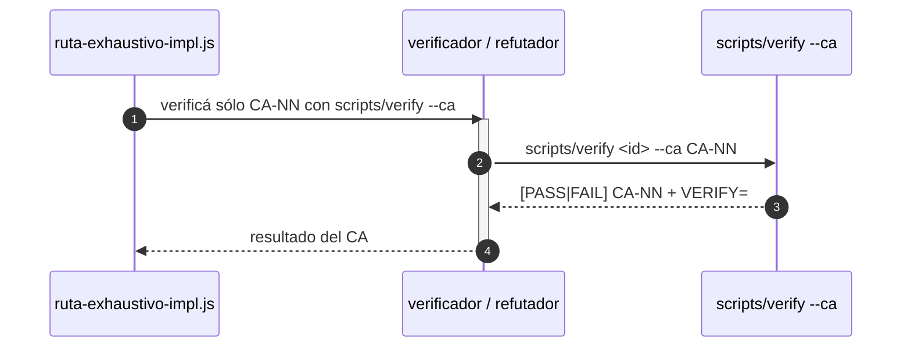

# SPEC — verify --ca: un CA por scripts/verify, nunca el check copiado a mano

**Spec madre:** `specs/0001-repo-maestro.md`. Hija de 0005 (`scripts/verify`),
0021 (rutas) y 0035 (deny de git destructivo). La ruta exhaustiva lanza un
verificador por CA y le ordena "corré su bloque `check:` tal cual está en
§6" (`ruta-exhaustivo-impl.js`), y al refutador "volvé a correr el
`check:`"; el agente `verificador` dice lo mismo para un solo CA. Copiar
el check a mano tiene dos problemas: desde 0035, un `check:` que usa `git
checkout` o `git stash` dentro de un clon temporal (p. ej. CA-04 de 0026)
lo frena el `deny` y da un FAIL que no es de la implementación; y aun sin
eso, el agente puede copiarlo mal. `scripts/verify` es un script: sus
comandos no pasan por la allowlist y corren el `check:` exacto. Esta spec
agrega `--ca` a `scripts/verify` y hace que verificador, refutador y
workflow lo usen. Ante conflicto, gana la madre.

**Destinatario:** agente de implementación con acceso a shell, filesystem
local y git. Esta spec se implementa por `scripts/ruta` (headless) a
propósito: toca `.claude/agents/` y `.claude/workflows/`, y su corrida es
la prueba real que pide el CA-07 de 0034.

**Idioma:** documentación y comentarios en español rioplatense;
identificadores, paths y claves de config en inglés.

---

```yaml
id: "0036"
title: "verify --ca: un CA por scripts/verify, nunca el check copiado a mano"
version: 2
status: verified
created_at: 2026-09-28
updated_at: 2026-09-28
schema_change: false
arch_decision: false
target_branch: "spec/0036-verify-ca"
loc_estimate: 90
tier_locked: null
supersedes: null
```

---

## 1. Objetivo

Que verificar o refutar un CA suelto corra exactamente el `check:` de la
spec, por `scripts/verify`, y no una copia hecha por un agente que la
allowlist puede frenar o que puede salir distinta.

---

## 2. Alcance

### 2.1 Dentro de alcance (IN)

- `scripts/verify <id> --ca CA-NN [--ca CA-MM ...]`.
- `.claude/agents/verificador.md`: un solo CA → `scripts/verify <id> --ca`.
- `.claude/agents/refutador.md`: re-correr un CA → `scripts/verify <id>
  --ca`; la línea de RF-04 de 0035 pasa a nombrar `--ca`.
- `.claude/workflows/ruta-exhaustivo-impl.js`: los prompts del verificador
  por CA y del refutador nombran `scripts/verify <spec> --ca <ca>`.
- Fixture y una línea en `docs/rutas-agenticas.md`.

### 2.2 Fuera de alcance (OUT)

- Cambiar qué evalúa `verify` o el formato de sus líneas.
- El implementador: ya dice `scripts/verify <id>` desde 0035.
- `ruta-directo.js` y `rutina-salud-repo.js`: sus verificadores corren la
  spec entera.

---

## 3. Requerimientos funcionales

**RF-01 — `scripts/verify --ca` (extiende RF-09 de la madre, 0005).**
`--ca CA-NN` (repetible) evalúa sólo esos CA, en el orden de §6, con las
mismas líneas `[PASS]`/`[FAIL]` de siempre y la línea `VERIFY=` con
`CA_TOTAL` = cantidad seleccionada. Con `--ca` no se evalúa el tope de
`max_manual_ratio` (sobre un subconjunto no mide nada). Un CA que no
existe en §6 → exit 2 con `verify: <CA> no existe en §6 de <id>`, sin
evaluar ninguno. Sin `--ca`, el comportamiento es byte a byte el de hoy.

**RF-02 — El verificador no copia checks.** En `verificador.md`, "Si el
prompt te pide un solo CA" pasa a: corrés `scripts/verify <id> --ca
<CA>` y reportás esa línea; nunca copiás el bloque `check:` a mano.

**RF-03 — El refutador re-corre por `verify`.** En `refutador.md`, dentro
de la sección `refutador-ca` de 0033: el `comando` de un `bug` es
`scripts/verify <id> --ca <CA>` (o un comando propio de lectura que
muestre el caso), no el `check:` copiado; y la línea de RF-04 de 0035
nombra `scripts/verify <id> --ca <CA>`.

**RF-04 — El workflow lo pide así.** En `ruta-exhaustivo-impl.js`, el
prompt del verificador por CA dice `Verificá sólo ${ca}: corré scripts/verify
${spec} --ca ${ca} y devolvé esa línea` y el del refutador `volvé a
correr scripts/verify ${spec} --ca ${ca}`. `derivarVeredicto` de 0033 no
cambia.

---

## 4. Requerimientos no funcionales

**RNF-01 — Compatibilidad.** `scripts/verify <id>` sin `--ca` no cambia:
mismas líneas, mismo exit. Los CA de 0005 siguen pasando.

**RNF-02 — Sin dependencias nuevas.** bash, como `scripts/verify`.

---

## 5. Estructura del entregable

### 5.1 Archivos nuevos o reemplazados

```
scripts/verify                                  # --ca repetible
.claude/agents/verificador.md                   # un solo CA → verify --ca (RF-02)
.claude/agents/refutador.md                     # comando de bug y RF-04 de 0035 con --ca (RF-03)
.claude/workflows/ruta-exhaustivo-impl.js       # prompts de verificador y refutador (RF-04)
tests/fixtures/verify/spec-ca.md                # nuevo: spec mínima con 3 CA (PASS, FAIL, MANUAL)
tests/fixtures/verify/verify-0033.expected      # nuevo: salida de verify 0033 antes de esta spec (ya generado)
docs/rutas-agenticas.md                         # una línea: verify --ca
```

### 5.3 Secuencia

```diagrama
capas:
  - { id: ruta, nombre: "Ruta exhaustiva" }
  - { id: repo, nombre: "Scripts del repo" }
participantes:
  - { id: WF, nombre: "ruta-exhaustivo-impl.js", capa: ruta, hace: "lanza un verificador y un refutador por CA", vive_en: [".claude/workflows/ruta-exhaustivo-impl.js"] }
  - { id: VER, nombre: "verificador / refutador", capa: ruta, hace: "verifica o re-corre un CA", vive_en: [".claude/agents/verificador.md", ".claude/agents/refutador.md"] }
  - { id: VS, nombre: "scripts/verify --ca", capa: repo, hace: "corre el check: exacto, fuera de la allowlist", vive_en: ["scripts/verify"] }
secuencia:
  - { de: WF, a: VER, msg: "verificá sólo CA-NN con scripts/verify --ca", tipo: peticion, activa: true }
  - { de: VER, a: VS, msg: "scripts/verify <id> --ca CA-NN", tipo: peticion }
  - { de: VS, a: VER, msg: "[PASS|FAIL] CA-NN + VERIFY=", tipo: respuesta }
  - { de: VER, a: WF, msg: "resultado del CA", tipo: respuesta }
```

<!-- diagrama:inicio -->


| Capa | Participante | Qué hace | Dónde vive |
|---|---|---|---|
| Ruta exhaustiva | ruta-exhaustivo-impl.js | lanza un verificador y un refutador por CA | `.claude/workflows/ruta-exhaustivo-impl.js` |
| Ruta exhaustiva | verificador / refutador | verifica o re-corre un CA | `.claude/agents/verificador.md`, `.claude/agents/refutador.md` |
| Scripts del repo | scripts/verify --ca | corre el check: exacto, fuera de la allowlist | `scripts/verify` |
<!-- diagrama:fin -->

Regenerar con `scripts/diagrama <id>`; el bloque entre marcadores no se
edita a mano.

---

## 6. Criterios de aceptación

Binarios. La spec está cumplida si y sólo si los 7 pasan.

- **CA-01** — `--ca` evalúa sólo lo pedido: sobre el fixture, `--ca
  CA-01` imprime sólo `[PASS] CA-01` y `CA_TOTAL=1`, exit 0; `--ca CA-02`
  imprime `[FAIL] CA-02`, exit 1; `--ca CA-01 --ca CA-03` imprime las dos
  en orden de §6.
  ```yaml
  check:
    cmd: |
      f=tests/fixtures/verify/spec-ca.md
      a=$(scripts/verify "$f" --ca CA-01); ra=$?
      [ "$ra" -eq 0 ] && [ "$(printf '%s\n' "$a" | grep -c '^\[')" -eq 1 ] &&
      printf '%s' "$a" | grep -q '^\[PASS\] CA-01$' && printf '%s' "$a" | grep -q 'CA_TOTAL=1 ' &&
      b=$(scripts/verify "$f" --ca CA-02); rb=$?; [ "$rb" -eq 1 ] && printf '%s' "$b" | grep -q '^\[FAIL\] CA-02' &&
      c=$(scripts/verify "$f" --ca CA-03 --ca CA-01; true) &&
      [ "$(printf '%s\n' "$c" | grep -o '^\[[A-Z]*\] CA-0[13]' | cut -d' ' -f2 | tr '\n' ' ')" = "CA-01 CA-03 " ]
    expect_exit: 0
  ```

- **CA-02** — CA inexistente: exit 2 con el mensaje de RF-01 y ninguna
  línea `[PASS]`/`[FAIL]`.
  ```yaml
  check:
    cmd: |
      out=$(scripts/verify tests/fixtures/verify/spec-ca.md --ca CA-99 2>&1); rc=$?
      [ "$rc" -eq 2 ] && printf '%s' "$out" | grep -q 'CA-99 no existe' && ! printf '%s' "$out" | grep -q '^\['
    expect_exit: 0
  ```

- **CA-03** — Sin `--ca` nada cambia: la salida y el exit de
  `scripts/verify 0033` son idénticos a
  `tests/fixtures/verify/verify-0033.expected`, generado con el
  `scripts/verify` anterior a esta spec (al redactarla, 2026-09-28).
  ```yaml
  check:
    cmd: |
      b=$(scripts/verify 0033 2>&1; echo "rc=$?")
      [ "$b" = "$(cat tests/fixtures/verify/verify-0033.expected)" ]
    expect_exit: 0
  ```

- **CA-04** — Los dos agentes nombran `scripts/verify <id> --ca` y el
  verificador ya no dice que copia el `check:` tal cual.
  ```yaml
  check:
    cmd: |
      grep -q 'scripts/verify <id> --ca' .claude/agents/verificador.md &&
      grep -q 'scripts/verify <id> --ca' .claude/agents/refutador.md &&
      ! grep -q 'corrés su bloque `check:` tal cual' .claude/agents/verificador.md
    expect_exit: 0
  ```

- **CA-05** — El workflow pide `--ca` al verificador y al refutador, y
  sigue válido.
  ```yaml
  check:
    cmd: |
      f=.claude/workflows/ruta-exhaustivo-impl.js
      [ "$(grep -c 'scripts/verify ${spec} --ca ${ca}' "$f")" -ge 2 ] &&
      ! grep -q 'corre su bloque check: tal cual' "$f" && scripts/rutas --lint >/dev/null
    expect_exit: 0
  ```

- **CA-06** — Prueba real (la medición que pide el CA-07 de 0034): esta
  spec se implementa con `scripts/ruta directo 0036`; la corrida termina
  con `task_notification` `completed` y dura más de 10 minutos, y su
  `run_id`, duración y denegaciones sobre `.claude/` quedan en §Historial
  de esta spec y de 0034. Si hubo denegaciones sobre `.claude/`, los
  archivos de `.claude/` de esta spec se terminan desde la sesión (D3).
  ```yaml
  manual: true
  signed_off_by: "Ivan Charczuk"
  signed_off_at: 2026-09-28
  # wf_6dd33509-2cc: completed, 667.805 ms (11,1 min), 4 agentes, 142.825
  # tokens. Denegados 9 Edit + 1 Write sobre .claude/agents pese a las
  # reglas de 0034: el harness protege .claude/ en claude -p. verificador.md,
  # refutador.md y ruta-exhaustivo-impl.js terminados desde la sesión.
  ```

- **CA-07** — `scripts/spec lint 0036` y `scripts/doctor` en verde.
  ```yaml
  check:
    cmd: "scripts/spec lint 0036 && scripts/doctor"
    expect_exit: 0
  ```

---

## 7. Dependencias y bloqueos

**D1 — Por qué no alcanza con el prompt.** Aun sin el `deny`, un agente
que copia un `check:` multilínea con comillas y `$` puede correr otra
cosa; `--ca` elimina la copia.

**D2 — CA-06 depende de que la Mac esté despierta.** Una ruta de ~20 min
por `scripts/ruta` con la máquina suspendida se estira (visto el
2026-09-27). Correrla con el operador presente o con la tapa abierta.

**D3 — Si el harness protege `.claude/` igual.** Si la corrida real
muestra denegaciones de `Edit` sobre `.claude/` pese a las reglas de
0034, se reabre 0034 (su D2), no se prueba `bypassPermissions`; esta spec
se termina desde la sesión y el CA-06 lo dice.

---

## 8. Datos e integridad

**8.1** Sólo scripts, prompts y un fixture; no toca registros ni specs
salvo §Historial de 0034 y 0036 (resultado del CA-06).

---

## §Historial

- 2026-10-27 — v1 — "foto pública: el historial interno no se publica" — operator

## §Traza

*(vacío — se completa con `scripts/spec trace <id>` una vez que exista)*
