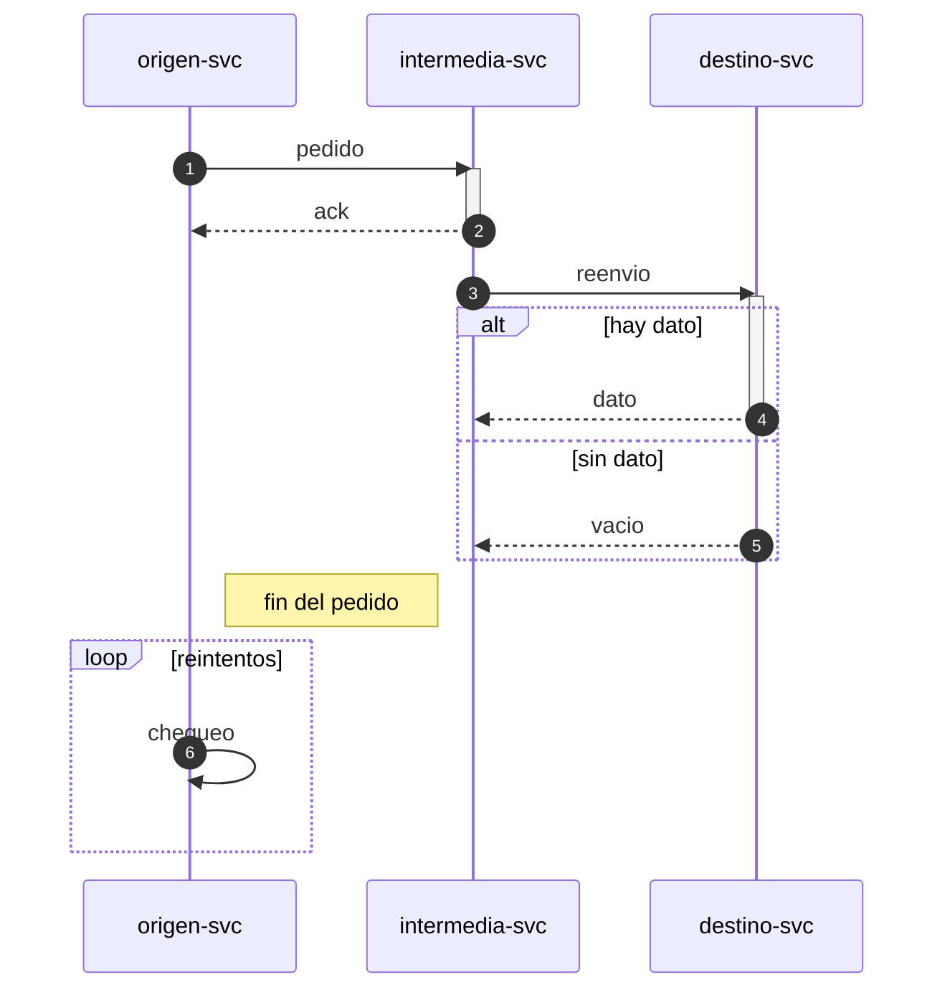

# SPEC — Fixture de prueba (diagrama mínima)

**Spec madre:** `specs/0001-repo-maestro.md`. Fixture de test para
spec 0025 (not in this snapshot),
no es una spec real.

**Destinatario:** ninguno — fixture de test.

**Idioma:** español rioplatense.

---

```yaml
id: "9002"
title: "Fixture de prueba (diagrama) — mínima"
version: 1
status: approved
created_at: 2026-09-16
updated_at: 2026-09-16
schema_change: false
arch_decision: false
target_branch: "sandbox/fixture"
loc_estimate: 10
tier_locked: null
supersedes: null
```

---

## 1. Objetivo

Fixture de test, sin contenido real.

---

## 2. Alcance

### 2.1 Dentro de alcance (IN)

- Nada real, es un fixture.

### 2.2 Fuera de alcance (OUT)

- Todo lo demás.

---

## 3. Requerimientos funcionales

**RF-01 — Requerimiento de prueba.** Texto de prueba.

---

## 4. Requerimientos no funcionales

**RNF-01 — Requerimiento no funcional de prueba.** Texto de prueba.

---

## 5. Estructura del entregable

Sin archivos reales.

### 5.3 Secuencia

```diagrama
capas:
  - { id: origen, nombre: Origen }
  - { id: intermedia, nombre: Intermedia }
  - { id: destino, nombre: Destino }
participantes:
  - { id: O, nombre: "origen-svc", capa: origen, hace: "Dispara el pedido", vive_en: ["ejemplo/origen.sh"] }
  - { id: I, nombre: "intermedia-svc", capa: intermedia, hace: "Encola y reenvía", vive_en: ["ejemplo/intermedia.sh"] }
  - { id: D, nombre: "destino-svc", capa: destino, hace: "Procesa y responde", vive_en: ["ejemplo/destino.sh"] }
secuencia:
  - { de: O, a: I, msg: "pedido", tipo: peticion, activa: true }
  - { de: I, a: O, msg: "ack", tipo: respuesta }
  - { de: I, a: D, msg: "reenvio", tipo: peticion, activa: true }
  - alt: "hay dato"
    pasos:
      - { de: D, a: I, msg: "dato", tipo: respuesta }
    else: "sin dato"
    pasos_else:
      - { de: D, a: I, msg: "vacio", tipo: respuesta }
  - { nota: "fin del pedido", sobre: O }
  - loop: "reintentos"
    pasos:
      - { de: O, a: O, msg: "chequeo", tipo: peticion }
```

<!-- diagrama:inicio -->


| Capa | Participante | Qué hace | Dónde vive |
|---|---|---|---|
| Origen | origen-svc | Dispara el pedido | `ejemplo/origen.sh` |
| Intermedia | intermedia-svc | Encola y reenvía | `ejemplo/intermedia.sh` |
| Destino | destino-svc | Procesa y responde | `ejemplo/destino.sh` |
<!-- diagrama:fin -->

---

## 6. Criterios de aceptación

- **CA-01** — Criterio de prueba.
  ```yaml
  check:
    cmd: "true"
    expect_exit: 0
  ```

---

## 7. Dependencias y bloqueos

Ninguna.

---

## 8. Datos e integridad

Ninguna.

---

## §Historial

- 2026-09-16 — v1 — "fixture de test" — Ivan Charczuk

## §Traza

*(vacío)*
