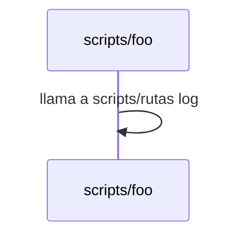

# SPEC — Fixture con diagrama (tests/fixtures/scorer)

Fixture sintética para CA-01 de `spec 0027 (not in this snapshot)...md`.
Es `minimal.md` con su fence de §5 envuelto en `### 5.1` más un `### 5.3
Secuencia` con un fence ```diagrama``` y uno ```mermaid``` con paths, para
probar que `signal_s2` los ignora (RF-01). No representa una spec real
(§8.4 de 0002).

```yaml
id: "9002"
title: "Fixture con diagrama"
version: 1
status: draft
schema_change: false
arch_decision: false
target_branch: "personal/fixture"
loc_estimate: 50
tier_locked: null
supersedes: null
```

## 1. Objetivo

Fixture de prueba, sin contenido real.

## 2. Alcance

### 2.1 Dentro de alcance (IN)

- Contenido sintético para probar el scorer.

### 2.2 Fuera de alcance (OUT)

- Cualquier uso real.

## 3. Requerimientos funcionales

**RF-01** — placeholder.
**RF-02** — placeholder.
**RF-03** — placeholder.

## 4. Requerimientos no funcionales

**RNF-01** — placeholder, no cuenta para el score.

## 5. Estructura del entregable

### 5.1 Archivos nuevos o reemplazados

```
scripts/foo
docs/bar.md
```

### 5.3 Secuencia

```diagrama
capas:
  - { id: x, nombre: "Capa X" }
participantes:
  - { id: A, nombre: "Cosa A", capa: x, hace: "hace algo", vive_en: ["scripts/foo", "docs/bar.md"] }
```

<!-- diagrama:inicio -->

<!-- diagrama:fin -->

## 6. Criterios de aceptación

- **CA-01** — placeholder.
- **CA-02** — placeholder.
- **CA-03** — placeholder.

## 7. Dependencias y bloqueos

Sin bloqueos declarados.

## 8. Datos e integridad

Sin marcas pendientes.

## §Historial

*(vacío — versión 1, borrador inicial, sin bumps todavía)*

## §Traza

*(vacío)*
